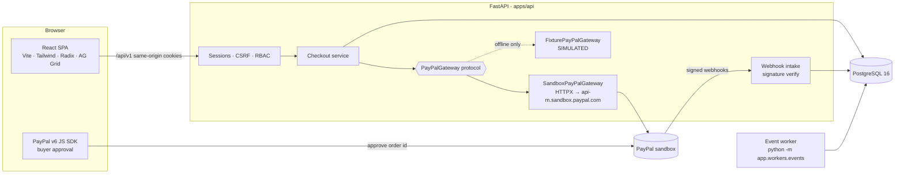

# Architecture

## Latest next-phase implementation — 6 November 2026

The new [technical report](NEXT_PHASE_REPORT.md) supersedes older feature-status and environment observations below. Guarded refunds, dispute preparation, validation-only Policy Lab, scoped monitoring/network views and a refreshed judge scenario are now implemented locally. Actual hosting, genuine PayPal/AI and remote bridge access remain separately blocked/unverified. See [setup](NEXT_PHASE_SETUP.md), [runbook](NEXT_PHASE_RUNBOOK.md), [architecture](NEXT_PHASE_ARCHITECTURE.md) and [demo](NEXT_PHASE_DEMO.md). Earlier dated inventories remain historical.

## Session 8 operational status — 22 October 2026

The current recovered branch adds supervised Supabase HTTP ingestion, durable scoring, exact-schema readiness, an administrator operations page and a private read-only judge scenario. The receiver is public; the Python application is still workspace-local. Certificate-host reachability now works; sandbox OAuth authentication failed. Real PayPal payments remain deliberately untested, and the real-AI test remains credential-gated. See [SESSION_8_REPORT.md](SESSION_8_REPORT.md), [HOSTING_READINESS.md](HOSTING_READINESS.md) and [PROVIDER_VERIFICATION.md](PROVIDER_VERIFICATION.md) for current evidence. Older dated results below are historical, not current deployment claims.

## Request path for a sandbox payment
1. SPA calls `POST /api/v1/paypal/orders` with `{product_id, quantity}` and an `Idempotency-Key`. No amount is accepted (extra fields → 422).
2. API loads the product for the caller's merchant, computes the amount in minor units, inserts a `transactions` row (`ORDER_CREATED`, `data_origin` from the gateway) and calls `POST /v2/checkout/orders` with `PayPal-Request-Id`.
3. SPA hands the order id to the v6 `PayPalOneTimePaymentButton`; the buyer approves in PayPal.
4. `onApprove` calls `POST /api/v1/paypal/orders/{id}/capture`. The API locks the row (`SELECT … FOR UPDATE OF transactions`), returns early if already captured, otherwise captures with deterministic `PayPal-Request-Id = sentinel-capture-{txn}`, and compares the captured amount to the expected amount. Mismatch → `CAPTURE_FAILED` with reason, never `CAPTURED`.
5. PayPal sends `PAYMENT.CAPTURE.*` webhooks; intake verifies, stores, acknowledges, then reconciles (status precedence prevents regression).

## Module boundaries (`apps/api/app`)
- `core/` config (typed env), JSON logging with redaction, correlation-id + security-header middleware, domain errors → consistent error objects.
- `auth/` passwords, sessions, rate limit, role dependencies.
- `models/` SQLAlchemy models and enums (single source of domain states; exported to the SPA via OpenAPI).
- `services/paypal/` gateway protocol, sandbox REST, fixture, parsing, factory.
- `services/` checkout, transactions, webhooks, audit.
- `api/v1/` thin routers.
- `workers/` durable event re-driver.

## Operating modes
- `SENTINEL_PAYPAL_MODE=sandbox` (default): real sandbox requests; requires credentials, otherwise order endpoints return 503 with `credential_dependency: true` (no silent fallback).
- `SENTINEL_PAYPAL_MODE=fixture`: offline; every record is `SIMULATED` and the UI shows "Simulated gateway".
- No live mode exists.

## Delivery plan (parallel, deadline 2026-11-12)
| Week of | Payments/backend | ML | AI/evidence | Frontend |
|---|---|---|---|---|
| Oct 10 | Phase 0–1 slice ✅, Phase 2 webhooks ✅ | Dataset download scripts, Track B generator | — | Shell, tokens, 5 screens ✅ |
| Oct 17 | Live sandbox run, cases + review queue | Track A/B training, evaluation report | Agent tools + schema | Workbench layout |
| Oct 24 | Approvals + refund path, disputes capability detection | SHAP in API | Evidence upload + packet PDF | Workbench, evidence drawer |
| Oct 31 | Graph analytics, policy lab | Policy cost model | Prompt-injection tests | Graph explorer, policy lab |
| Nov 7 | Deploy (Render + Vercel), security pass | — | — | Polish, video recording |

## Current hosted-inbox path

```mermaid
flowchart LR
  PayPal --> Edge[Existing Supabase receiver]
  Edge --> Inbox[(Private leased inbox)]
  Inbox --> Bridge[Supervised HTTP bridge]
  Bridge --> API[FastAPI verifier + durable receipt]
  API --> Events[(Application event store)]
  Events --> Reconcile[Supervised reconciliation]
  Reconcile --> Jobs[(Durable scoring jobs)]
  Jobs --> Model[Unchanged model + SHAP]
  Model --> Case[HIGH-risk case]
  Case --> Investigation[Investigation / private evidence / packet / approval]
```

Inbox acceptance, reconciliation, scoring, investigation and approval are distinct stages. Snapshot metrics are sampled by the existing bridge, not by browser service-role access. Worker observability adds nullable fields to application PostgreSQL only. See WEBHOOK_OPERATIONS.md.
