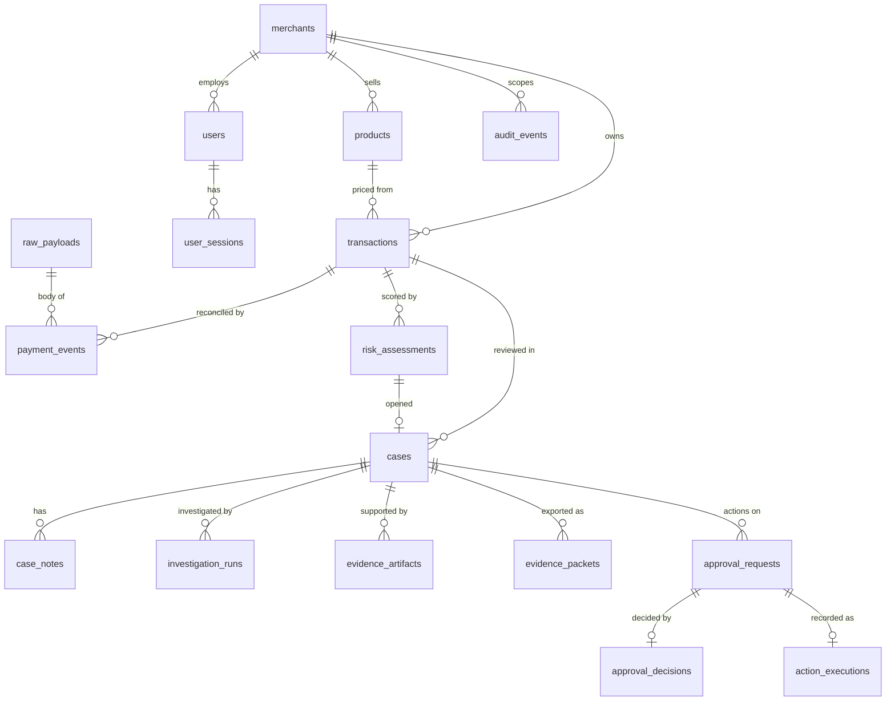

# Database Schema

Migrations, all round-trip tested (`alembic downgrade base && alembic upgrade head`, also run by
the test suite on every session):
- `20261010_9918334b15aa_initial_schema.py`
- `20261010_67fa573a3cac_risk_assessments_and_cases.py`
- `20261011_f3742645a803_investigations_evidence_approvals.py` (Phase 4)

| Table | Key columns | Constraints / notes |
|---|---|---|
| merchants | id, name, status, environment (SANDBOX/DEMO) | |
| users | merchant_id, email, password_hash (Argon2id), role, last_login_at | unique email |
| user_sessions | user_id, token_digest, csrf_digest, expires_at, revoked_at | only SHA-256 digests stored |
| products | merchant_id, sku, price_minor, currency | unique (merchant, sku); price > 0; ISO currency length |
| transactions | merchant_id, product_id, quantity, paypal_order_id, paypal_capture_id, amount_minor, currency, status, provider_status, payer_reference, create_idempotency_key, paypal_request_id, provider_summary (JSONB, redacted subset), failure_reason, data_origin, occurred_at, refunded_at, disputed_at | unique order id, capture id, (merchant, idempotency key); amount > 0; indexes (merchant, created_at), (merchant, origin, occurred_at), (merchant, origin, payer, occurred_at) for past-only feature lookups |
| payment_events | provider_event_id, provider_event_type, resource_id, payload_sha256, payload_reference → raw_payloads, transmission_id, verification_status, processing_status, delivery_count, attempts, data_origin, occurred_at, received_at, processed_at, error_reason | unique provider_event_id |
| raw_payloads | sha256, body (bytea) | restricted store; no API exposes it |
| risk_assessments | merchant_id, transaction_id, model_version, feature_version, risk_score (calibrated, 0–1), risk_band, policy_decision, policy_mode (SHADOW), thresholds, feature_snapshot, explanation (TreeSHAP), limitations, data_origin (of the scored payment), trigger, created_by_user_id | append-only, so the latest row is shown; check that the score is in [0,1]; index (transaction, created_at) |
| cases | merchant_id, transaction_id, risk_assessment_id, source (RISK_MODEL/MANUAL), status (OPEN/IN_REVIEW/RESOLVED), priority, title, assignee_id, due_at, resolution, resolution_note, resolved_at/by, data_origin | partial unique index: at most one unresolved case per transaction; check that a resolution is set only when the case is resolved |
| case_notes | case_id, author_id, body | the note text is never copied into the audit log |
| investigation_runs | merchant_id, case_id, transaction_id, initiated_by_user_id, status (QUEUED/RUNNING/COMPLETED/FAILED), mode (AI_AGENT/DETERMINISTIC), provider, model_name, prompt_version, findings (JSONB, validated), tool_calls (JSONB), source_refs (JSONB), usage, error_category, error_message, data_origin, created/started/completed_at, duration_ms | partial unique index: one QUEUED/RUNNING run per case; checks: findings iff COMPLETED, error_category iff FAILED; append-only history |
| evidence_artifacts | merchant_id, case_id, uploaded_by_user_id, category (uploader's label), description, original_filename (sanitised, display only), content_type, size_bytes, sha256, storage_backend, storage_key (server-generated), extraction_status, extraction_note, extracted_text, page_count, data_origin (always MERCHANT_PROVIDED) | unique (case, sha256); unique storage_key; size > 0 |
| stored_blobs | key, body (bytea) | bytes for the `database` storage backend only |
| evidence_packets | merchant_id, case_id, investigation_run_id, generated_by_user_id, sha256, size_bytes, page_count, storage_backend, storage_key, contents (JSONB list of included record ids) | generated PDFs; not PayPal submissions |
| approval_requests | merchant_id, case_id, transaction_id, action_type (MANUAL_REVIEW/EVIDENCE_PACKET_INTERNAL/PREPARE_REFUND), action_snapshot (JSONB, server-built), snapshot_sha256, required_roles, justification, status (PENDING/APPROVED/REJECTED), requested_by_user_id, investigation_run_id, data_origin, created_at, decided_at | partial unique: one PENDING request per (case, action); trigger blocks changes to the snapshot, action, case, merchant, requester or roles, and any status change after a decision; decided_at iff decided |
| approval_decisions | approval_request_id (unique), merchant_id, decision, decided_by_user_id, decided_by_role, comment, snapshot_sha256 | one per request; trigger blocks UPDATE |
| action_executions | approval_request_id (unique), merchant_id, action_type, status (COMPLETED_INTERNAL/NOT_EXECUTED), provider_called, detail | check `provider_called = false` (no provider calls in Phase 4) |
| audit_events | merchant_id, actor_id, actor_type, action, entity_type, entity_id, correlation_id, metadata (JSONB, redacted) | index (merchant, created_at) |

Money is always integer minor units + ISO-4217 code. All timestamps are `timestamptz`.
Buyer email and name from PayPal responses are not persisted; only `payer_id` as `payer_reference`.

## Planned tables (added with the phase that uses them)
model_versions (when a second model exists) · disputes, graph_entities,
graph_edges, policy_versions (Phase 5). Field lists follow the project brief §8.
