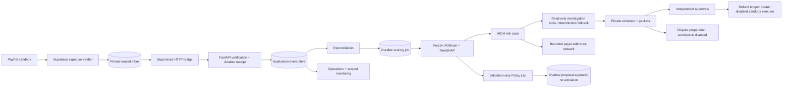

# Reliability and next-phase architecture

The recovered FastAPI/React/PostgreSQL application is extended in place. The application database and Supabase private inbox remain separate persistence domains.

## New boundaries

- Refunds have their own immutable request snapshot and independent decision. Existing Phase 4 intent-only `action_executions.provider_called=false` remains unchanged. The new `submission_started` field is deliberately uncertain: a durable pre-call transition cannot prove a request reached PayPal. Refunds reserve balance under transaction locks, refuse unknown external refund balances and never automatically resubmit an ambiguous outcome.
- Disputes map only exact owned LIVE_SANDBOX captures during read-only sync. Demonstrations are explicit nonprovider records; drafts cite stored evidence and expose gaps. External submission is hard-disabled. First-page-only sync and ambiguous multi-payment mappings are explicit limits.
- Policy Lab reconstructs the validation split using the unchanged frozen model. It never fits a model, scores test rows for tuning or activates thresholds. Saved policy proposals and approved snapshots remain shadow-only.
- Monitoring uses explicit merchant, origin and time boundaries. PSI uses stated reference/current windows and sample sufficiency checks; it is not a fraud/degradation verdict. Calibration is unavailable without trustworthy labels. Network edges represent actual payer references and case/payment links; no device/card/IP identity is invented.
- Investigation tools can read these local dispute and shadow-policy records, plus bounded prior payer neighbors. Returned records join the existing citation allowlist. Provider/model output remains budgeted, validated and human-reviewed; financial mutation tools are never exposed.

## Migration

`d105a4143283`, parent `8ab7245e13c0`, adds `refund_requests`, `disputes`, `dispute_drafts` and `policy_drafts`. It reuses the existing `data_origin` enum. Snapshot and decision immutability are enforced by PostgreSQL triggers; executed/ambiguous refund history uses restrictive foreign keys. No historical payment/case/audit timestamp is rewritten. Automatic deployment migration targets this reviewed revision; future unreviewed heads are not implicitly applied.
