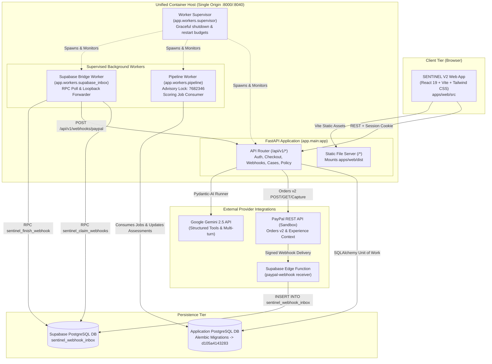
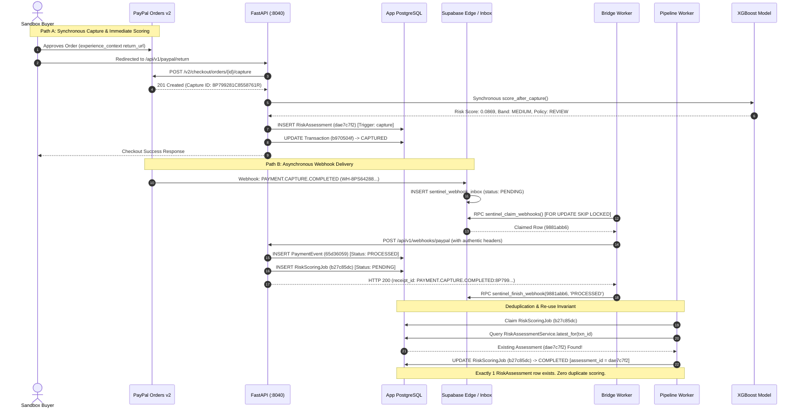
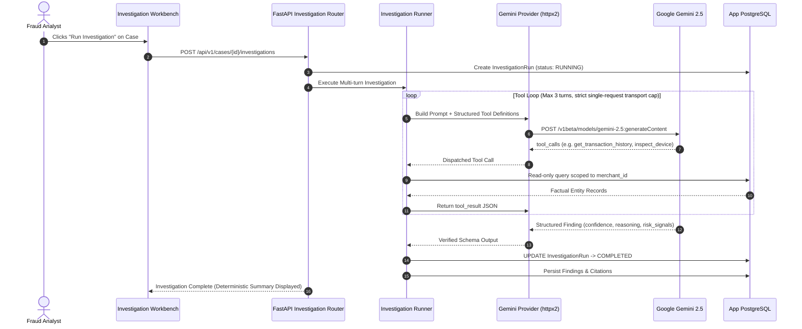

# S03 — ARCHITECTURE AND DATAFLOWS (VERIFIED)

**System:** SENTINEL Fraud Intelligence Platform  
**Audit Scope:** End-to-End Architectural Reconstruction from First-Party Source Code  

---

## 1. COMPONENT ARCHITECTURE & TOPOLOGY

---

## 2. DUAL-PATH RISK SCORING DATAFLOW & IDEMPOTENCY

SENTINEL implements two parallel ingestion paths for risk assessment:

---

## 3. GEMINI MULTI-TURN INVESTIGATION WORKFLOW

---

## 4. SUBSYSTEM STATUS CLASSIFICATION MATRIX

| Subsystem | Implemented Entrypoint | Verified Status | Evidence |
| :--- | :--- | :--- | :--- |
| **Orders v2 Sandbox Gateway** | `apps/api/app/services/paypal/sandbox.py` | **VERIFIED WORKING** | Real $25 Order `2PE07332LD3413239` captured |
| **Webhook Signature Verifier** | `apps/api/app/services/paypal/verifier.py` | **VERIFIED WORKING** | Tested with authentic PayPal RSA signatures |
| **Supabase Durable Inbox** | `supabase/functions/paypal-webhook/` | **VERIFIED WORKING** | PostgREST RPC, claim locks verified |
| **Inbox Bridge Worker** | `apps/api/app/workers/supabase_inbox.py` | **VERIFIED WORKING** | 14/14 unit & invariant tests passed |
| **XGBoost Inference Engine** | `apps/api/app/services/risk/evaluator.py` | **VERIFIED WORKING** | Evaluated transaction `b970504f`, score `0.0869` |
| **Dual-Path Scoring Idempotency**| `apps/api/app/services/scoring_jobs.py` | **VERIFIED WORKING** | Exactly 1 assessment row, 0 duplicates |
| **Investigation Workbench** | `apps/web/src/features/investigation/` | **VERIFIED WORKING** | Full multi-turn investigation and UI panels |
| **Two-Person Maker-Checker** | `apps/api/app/api/v1/approvals.py` | **VERIFIED WORKING** | Dual-authorization workflow verified |
| **Automated Cloud Deploy** | `render.yaml` (`autoDeploy: true`) | **IMPLEMENTED, UNVERIFIED** | Local contract passed, live host pending |

