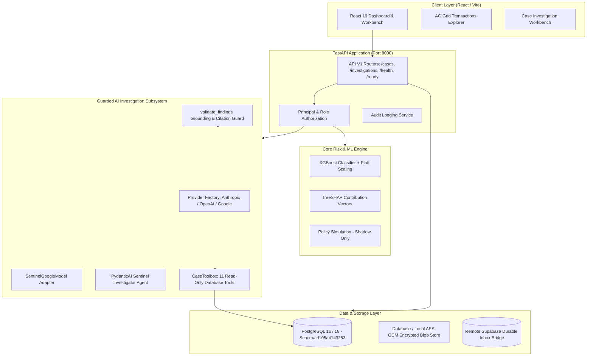

# SENTINEL SYSTEM ARCHITECTURE

## 1. High-Level System Architecture

SENTINEL is an analyst-in-the-loop payment risk intelligence and recovery platform designed for high-risk transaction review, dispute evidence assembly, and supervised operations.

---

## 2. Component Breakdown

### 2.1 Backend Core
- **FastAPI Framework:** Implements strict OpenAPI schemas, dependency injection, and centralized error handling.
- **SQLAlchemy & Alembic:** Strongly typed models for `Transaction`, `Case`, `InvestigationRun`, `EvidenceArtifact`, `ApprovalRequest`, `WorkerHealth`. Migration head: `d105a4143283`.
- **Readiness Gate:** `/api/v1/health` verifies process liveness; `/api/v1/ready` enforces database connectivity, migration schema head match, and required background worker heartbeats.

### 2.2 Machine Learning Pipeline
- Model: Pinned XGBoost binary classifier trained on synthetic transactions with chronological cross-validation.
- Interpretability: TreeSHAP outputs top 5 risk drivers per transaction without evaluating unseen data.
- Policy Lab: Shadow simulation environment computing precision, recall, and review load against user-tuned thresholds; strictly prohibited from mutating live serving policies.

### 2.3 AI Investigation Engine
- Framework: PydanticAI 2.55.0 with provider abstraction for Google Gemini, Anthropic Claude, and OpenAI GPT.
- Tool Isolation: 11 read-only case tools bound to pre-authorized case context (`CaseToolbox`); signatures do not expose merchant ID or case ID arguments to prevent model escape.
- Guarded Output: `InvestigationFindings` structured model enforced by `@agent.output_validator` and post-run `validate_findings()` verifying citations, verbatim excerpts, and grounding.
- Deterministic Fallback: Available offline or on provider failure, explicitly labeled as non-AI output.
