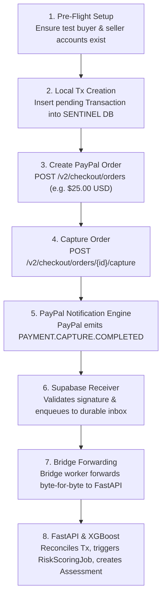

# Controlled PayPal Sandbox End-to-End Test Proposal

**Goal:** Create exactly ONE genuine PayPal Sandbox transaction to trigger an authentic `PAYMENT.CAPTURE.COMPLETED` webhook delivery, verify its intake through Supabase, bridge it to FastAPI, score it with XGBoost, and verify risk assessment creation.

---

## 1. Safety & Financial Boundaries

> [!CAUTION]
> **Strict Non-Financial / Zero-Cost Guarantees:**
> - Environment: **PayPal Sandbox Only** (`https://api-m.sandbox.paypal.com`).
> - Mode: Zero real money, zero production accounts, zero credit cards.
> - Funds Moved: Strictly simulated Sandbox play money between Sandbox test buyer and Sandbox test facilitator.
> - Billing Exposure: **Zero ($0.00 USD)**. Sandbox operations incur no charges or transaction fees.
> - Refund Lock: `SENTINEL_REFUND_EXECUTION_ENABLED = false` remains strictly enforced.
> - Maximum External Requests: **3** (1 OAuth Token, 1 Create Order, 1 Capture Order).
> - Zero Retries on Failure: If any step fails, stop immediately and report exact error diagnostics.

---

## 2. Step-by-Step Execution Plan



### Detail of Operations:

#### Operation 1: Local Transaction Setup
- Create a `Transaction` row in SENTINEL's local database:
  - `amount_minor = 2500` ($25.00 USD)
  - `currency = "USD"`
  - `status = TransactionStatus.ORDER_CREATED`
  - `data_origin = DataOrigin.LIVE_SANDBOX`
  - `payer_reference = "SANDBOX-BUYER-TEST"`

#### Operation 2: Create Sandbox Order
- Request: `POST https://api-m.sandbox.paypal.com/v2/checkout/orders`
- Headers:
  - `Authorization: Bearer <IN_MEMORY_TOKEN>`
  - `Content-Type: application/json`
- Body:
  ```json
  {
    "intent": "CAPTURE",
    "purchase_units": [
      {
        "reference_id": "<SENTINEL_TXN_ID>",
        "amount": {
          "currency_code": "USD",
          "value": "25.00"
        }
      }
    ]
  }
  ```
- Extracts `order_id` (e.g. `5O...`). Updates local `Transaction.paypal_order_id = order_id`.

#### Operation 3: Capture Order
- Request: `POST https://api-m.sandbox.paypal.com/v2/checkout/orders/{order_id}/capture`
- Extracts `capture_id` (e.g. `CAP...`).
- This triggers PayPal Sandbox to generate the genuine `PAYMENT.CAPTURE.COMPLETED` webhook.

#### Operation 4: Delivery & Pipeline Verification
1. Probe PayPal event history (`GET /v1/notifications/webhooks-events`) to capture the authentic `event_id`.
2. Inspect Supabase inbox to confirm the Edge Function received and inserted the event.
3. Run `python -m app.workers.supabase_inbox --once` to claim and forward the event to FastAPI.
4. Verify FastAPI receipt returns `verification_status: "VERIFIED"`.
5. Run `python -m app.services.risk.jobs` to execute XGBoost inference.
6. Verify `RiskAssessment` row is committed in PostgreSQL with `data_origin = 'LIVE_SANDBOX'`.

---

## 3. Stop Conditions

The test must abort immediately if:
1. OAuth token fails or returns non-200.
2. Order creation returns an error.
3. Capture is denied or pending buyer approval (requires interactive Sandbox buyer login).
4. Signature verification fails in the Supabase receiver.
5. Any financial mutation occurs outside Sandbox.

---

## 4. Required Explicit Authorization

Because creating a Sandbox order and capture is an active state change in PayPal Sandbox, this action is **NOT executed automatically**.  
To proceed, the project owner must review this proposal and provide explicit authorization.
