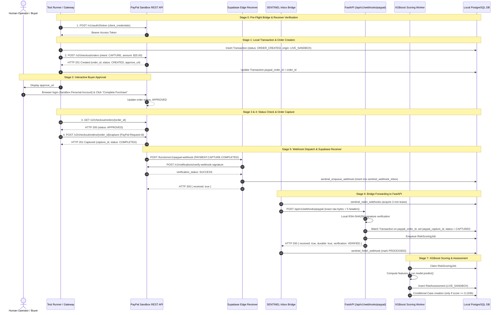

# Corrected PayPal Sandbox End-to-End Verification Plan

**Target Milestone:** Verify genuine PayPal Sandbox webhook delivery through Supabase, FastAPI, and XGBoost scoring.  
**Version:** 2.0 (Corrected Orders v2 Flow & Infrastructure Readiness)  
**Status:** PROPOSAL — AWAITING EXPLICIT OWNER AUTHORIZATION  

---

## 1. Corrections from Previous Proposal

Following review, two critical flaws in the initial proposal were identified and resolved:

1. **Buyer Approval Is Mandatory in Orders v2:**
   - In PayPal Orders v2, an order created via `POST /v2/checkout/orders` with `intent: "CAPTURE"` enters status `"CREATED"`.
   - Simply calling `POST /v2/checkout/orders/{id}/capture` immediately fails with `HTTP 422 UNPROCESSABLE_ENTITY` (`issue: "ORDER_NOT_APPROVED"`).
   - PayPal strictly requires the buyer to approve the order via the `rel: "approve"` URL before capture can execute.
   - **Correction:** The plan now explicitly incorporates the operator's manual Sandbox buyer approval step, updates the API request budget to 4 requests, and includes a pre-capture status verification check.

2. **Supabase Bridge Infrastructure Must Be Operational Prior to Transaction:**
   - Generating a genuine webhook before the Supabase inbox bridge is configured risks leaving the receipt stranded in the remote inbox.
   - **Correction:** Stage 0 now mandates pre-flight verification of `SENTINEL_SUPABASE_SERVICE_ROLE_KEY`, confirming `app.workers.supabase_inbox` can authenticate to `cfslzvvdjxstpupkqbpw.supabase.co` before any transaction is initiated.

3. **Realistic Risk Score Expectation:**
   - A fresh Sandbox transaction with clean history will typically score in the `LOW` or `MEDIUM` risk band.
   - **Correction:** The milestone success criterion is authentic webhook ingestion, signature validation, transaction reconciliation, and `RiskAssessment` creation. A `Case` is created only if the score organically exceeds the high threshold (`0.1036`). No features or thresholds are falsified.

---

## 2. Documented Orders v2 Checkout Architecture



---

## 3. Detailed Stage-by-Stage Execution Plan

### Stage 0: Pre-Flight Bridge & Receiver Verification
Before dispatching any external order requests:
1. Verify `SENTINEL_SUPABASE_SERVICE_ROLE_KEY` is present in the environment.
2. Probe Supabase RPC endpoint `POST /rest/v1/rpc/sentinel_claim_webhooks` with dummy origin check to confirm RPC connectivity and authentication.
3. Verify local FastAPI backend is active and healthy (`GET /api/v1/ready` returns 200).
4. **Stop condition:** If Supabase service role key is missing or RPC returns 401/403, abort immediately. Do not generate orphaned webhook traffic.

### Stage 1: Transaction Mapping & Order Creation
1. Insert a pending `Transaction` into local database:
   - `merchant_id`: Active Sandbox merchant ID.
   - `amount_minor`: `2500` ($25.00 USD).
   - `currency`: `"USD"`.
   - `status`: `TransactionStatus.ORDER_CREATED`.
   - `data_origin`: `DataOrigin.LIVE_SANDBOX`.
   - `create_idempotency_key`: `sentinel-sandbox-test-{uuid}`.
2. Call PayPal `POST /v2/checkout/orders`:
   - Request Body:
     ```json
     {
       "intent": "CAPTURE",
       "purchase_units": [
         {
           "reference_id": "<TRANSACTION_ID>",
           "amount": { "currency_code": "USD", "value": "25.00" }
         }
       ],
       "payment_source": {
         "paypal": {
           "experience_context": {
             "shipping_preference": "NO_SHIPPING",
             "user_action": "PAY_NOW"
           }
         }
       }
     }
     ```
3. Extract `order_id` (e.g., `5O...`) and update `Transaction.paypal_order_id = order_id`.
4. Extract `approve_url` from `links` where `rel == "approve"` (or `payer-action`).

### Stage 2: Manual Buyer Approval Step (Operator Action)
1. The runner outputs the approval URL:
   `https://www.sandbox.paypal.com/checkoutnow?token={order_id}`
2. The operator opens this URL in their browser.
3. The operator logs in with a PayPal Sandbox Personal Buyer account.
4. The operator clicks **"Pay Now"** / **"Complete Purchase"**.
5. The browser displays confirmation. The order status on PayPal is now `"APPROVED"`.

### Stage 3: Order Status Polling
1. Dispatch `GET /v2/checkout/orders/{order_id}`.
2. Confirm `status == "APPROVED"`.
3. **Stop condition:** If status is still `"CREATED"`, wait 10 seconds and retry once. If not approved, abort.

### Stage 4: Order Capture
1. Dispatch `POST /v2/checkout/orders/{order_id}/capture`:
   - Headers: `PayPal-Request-Id: sentinel-capture-{transaction_id}`.
2. Extract `capture_id` (e.g. `1XY...`), update local `Transaction.paypal_capture_id = capture_id`, and verify response `status == "COMPLETED"`.
3. This action causes PayPal Sandbox to emit `PAYMENT.CAPTURE.COMPLETED`.

### Stage 5: Webhook Receipt at Supabase Edge Function
1. PayPal dispatches POST to `https://cfslzvvdjxstpupkqbpw.supabase.co/functions/v1/paypal-webhook`.
2. Receiver validates headers, pre-verifies with PayPal, and executes `sentinel_enqueue_webhook`.
3. Event is safely stored in `public.sentinel_webhook_inbox` in status `'PENDING'`.

### Stage 6: Bridge Forwarding & Transaction Reconciliation
1. Run `app.workers.supabase_inbox` (`--once`).
2. Worker claims the row, attaches exact signature headers, and forwards raw UTF-8 bytes to `/api/v1/webhooks/paypal`.
3. FastAPI's `SignatureVerifier` validates the RSA-SHA256 signature against PayPal certificate hosts.
4. FastAPI's `_apply` reconciles the incoming capture:
   - Queries `Transaction` where `paypal_capture_id == capture_id OR paypal_order_id == order_id`.
   - **Match Found:** Matches via `paypal_order_id`!
   - Updates `Transaction.status = CAPTURED`, records `Transaction.paypal_capture_id = capture_id`.
   - Records audit event `paypal.webhook.status_applied`.
   - Enqueues `RiskScoringJob`.
5. Returns `HTTP 200 { received: true, durable: true, verification_status: "VERIFIED" }`.
6. Bridge acknowledges row with `sentinel_finish_webhook(p_success=True)`.

### Stage 7: XGBoost Scoring & Risk Assessment
1. Run `app.services.risk.jobs.run_once()`.
2. Worker extracts features (no temporal leakage).
3. XGBoost evaluates features and records `RiskAssessment`:
   - `data_origin`: `LIVE_SANDBOX`.
   - `feature_snapshot`: Full feature dictionary.
   - `explanation`: TreeSHAP log-odds breakdown.
4. If score $\ge 0.1036$, opens review `Case`. (If score $< 0.1036$, assessment is stored with band `LOW`/`MEDIUM` and no case is opened; pipeline is still 100% verified).

---

## 4. Strict Financial & Operational Safeguards

| Parameter | Safeguard Limit | Enforcement |
| :--- | :--- | :--- |
| **Environment** | PayPal Sandbox Only (`api-m.sandbox.paypal.com`) | Hard-coded base URL; no live host configuration |
| **Real Money Moved** | **$0.00 USD** | Sandbox test facilitator / buyer accounts only |
| **Billing Exposure** | **$0.00 USD** | Sandbox APIs are free; zero provider fees |
| **Orders Created** | Exactly **1** | Bounded test run |
| **Order Captures** | Exactly **1** | Idempotency key `sentinel-capture-{txn.id}` prevents duplicates |
| **API Request Budget** | Max **4** external HTTP requests | 1 Token, 1 Create, 1 Check, 1 Capture |
| **Automatic Retries** | **Zero (0)** | Hard fail on any unexpected status code |
| **Refund Execution** | **Locked False** | `SENTINEL_REFUND_EXECUTION_ENABLED = false` strictly enforced |

---

## 5. Stop Conditions & Abort Criteria

The execution harness will halt immediately without retrying if:
1. `SENTINEL_SUPABASE_SERVICE_ROLE_KEY` is not present or cannot authenticate to Supabase RPC.
2. Local FastAPI is not responding on `/api/v1/ready`.
3. PayPal OAuth returns non-200.
4. Order creation returns an error or fails validation.
5. Buyer approval link is not visited within a 5-minute timeout window.
6. Order capture fails or returns non-201.
7. Any attempt is made to contact live PayPal URLs (`api.paypal.com`).
